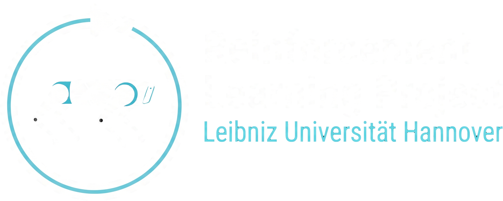

<p align="center">
  
</p>

# Reinforcement Learning Project

## Go2 VLA Navigation

Drive the real Unitree Go2 with a text prompt like "go to the white door".
[OmniVLA](https://github.com/NHirose/OmniVLA) picks the walking direction from the front camera,
and either our Isaac Lab RL policy or Unitree's sport mode moves the legs.
"Sport mode" is Unitree's name for the robot's built-in walking controller (active after power-on), not a high-speed mode; the speed comes from the commands, which our scripts cap.

### Setup

Hardware: a Go2 EDU with its remote, and a workstation with an NVIDIA GPU (≥20 GB only for the optional full VLA),
connected to the robot by Ethernet.

GitHub access: log in once with the [GitHub CLI](https://cli.github.com/) over HTTPS, so git can clone and push without a password
([details](https://docs.github.com/en/authentication/keeping-your-account-and-data-secure/about-authentication-to-github#https)):
```bash
gh auth login        # GitHub.com → HTTPS → yes, authenticate Git → log in with a web browser
gh repo clone LUH-AI/rl-project-WS26-27 && cd rl-project-WS26-27
```

Software: three [uv](https://docs.astral.sh/uv/) venvs, kept separate because their dependencies clash.
They exchange policies as `.npz` files and commands/camera frames over local UDP (`command_bus/`).
Each venv's versions are pinned in its `pyproject.toml` and `uv.lock` (root, `deploy/`, `vla/`), together with the commits of the `third_party/` repos in the install scripts.
```bash
./scripts/install_deploy.sh        # deploy/.venv: talks to the robot (unitree_sdk2_python)
./scripts/install_vla.sh           # vla/.venv: OmniVLA edge model (add --full for the full 7B model, ~16 GB)
./scripts/install_isaaclab.sh      # optional, .venv: Isaac Lab + unitree_rl_lab, only for training (step 2)
```

### 0. Connect to the robot

Find the Ethernet interface connected to the robot with `ip -br link` (here `enxf8e43b9f046a`).
Set it in **every terminal** that talks to the robot (steps 1 and 3, `look.sh`). The commands below read `GO2_IFACE`:
```bash
export GO2_IFACE=enxf8e43b9f046a
```
Check the link:
```bash
ip -br addr show $GO2_IFACE   # should list a 192.168.123.x address
ping 192.168.123.161          # the robot
```
**Optional, needs sudo:** only if no `192.168.123.x` address is listed, add one (lost on reboot, ask an admin to make it permanent):
```bash
sudo ip addr add 192.168.123.51/24 dev $GO2_IFACE
```

### 1. Test low-level commands

```bash
# read only: IMU, battery, joints
deploy/.venv/bin/python deploy/read_lowstate.py $GO2_IFACE
# robot lying down: releases sport mode, stands up and lies down again, Ctrl+C at the end
deploy/.venv/bin/python third_party/unitree_sdk2_python/example/go2/low_level/go2_stand_example.py $GO2_IFACE
```
Sport mode stays off afterwards. Switch it back on with `deploy/.venv/bin/python deploy/sport_mode.py --on` (the robot stands up), or reboot the robot. The full bring-up log is in [deploy/real_robot_setup.md](deploy/real_robot_setup.md).

### 2. Train an RL policy (optional)

You can skip this step: trained policies are ready in `deploy/example_policies/`,
`go2_velocity.npz` (standard gait) and `go2_crawl.npz` (crawl), and step 3 loads them directly.

To train your own (~25 min each on an RTX 4090, needs `./scripts/install_isaaclab.sh`):
```bash
source .venv/bin/activate
cd third_party/unitree_rl_lab
python scripts/rsl_rl/train.py --task Unitree-Go2-Velocity --headless --num_envs 4096 --max_iterations 2000        # standard
python scripts/rsl_rl/train.py --task Unitree-Go2-Velocity-Crawl --headless --num_envs 4096 --max_iterations 2000  # crawl
cd ../..
```
Our task configs are in `training/go2_tasks/`. Each run is saved in `third_party/unitree_rl_lab/logs/rsl_rl/unitree_go2_velocity[_crawl]/<date>/`.
Export it to a `.npz` for the robot (from the repo root, `<date>` is the run folder):
```bash
.venv/bin/python deploy/export_policy.py --out deploy/policies/my_crawl.npz \
  --run_dir third_party/unitree_rl_lab/logs/rsl_rl/unitree_go2_velocity_crawl/<date>
```
This uses the last checkpoint `model_1999.pt`; pass `--checkpoint model_<N>.pt` for another one.
To run your policy on the robot, pass it with `--policy` in step 3:
`--policy deploy/policies/my_crawl.npz` instead of `deploy/example_policies/go2_crawl.npz`.

### 3. Deploy the VLA with the RL policy

Robot lying down, floor clear, remote in hand. The VLA does not stop at the goal or avoid obstacles.
Terminals 1 and 2 need `GO2_IFACE` (step 0).
```bash
# Terminal 1: camera stream for the VLA
deploy/.venv/bin/python -m deploy.vla_bridge --camera-only --duration 600
# Terminal 2: RL policy. Enter releases sport mode, then use the keys below
deploy/.venv/bin/python deploy/run_policy.py $GO2_IFACE \
  --policy deploy/example_policies/go2_crawl.npz --cmd_source bus --bus_max_v 0.5
# Terminal 3: once in POLICY, start the VLA. Ctrl+C stops the robot
vla/.venv/bin/python -m vla --prompt "go to the wooden pallet" --max-v 0.5 --max-w 0.5
```
Keys for terminal 2 (type the key, then Enter) or the remote. These remote combos are ours and only work while `run_policy.py` runs, in sport mode the remote has Unitree's own bindings:

| Key | Remote | Does | Works from |
|-----|--------|------|------------|
| `s` | L2+A | stand up to the policy's start pose (2 s) | damping, lying |
| `p` | start | start the RL policy, it follows the VLA / sticks | standing (after the 2 s stand-up) |
| `l` | L2+X | lie down and hold the lying pose | standing, policy |
| `d` | L2+B | **damping**: legs go soft, the robot drops to the floor | any time |
| `q` / Ctrl+C | – | lie down if needed, then quit | any time |

> [!WARNING]
> **If the robot is about to hit something:**
>
> 1. Press Ctrl+C in the VLA terminal (3). The robot stops within ~0.5 s and stands in place. Moving a stick also overrides the VLA.
> 2. If it still moves dangerously or falls, press damping: L2+B on the remote (fastest, no Enter needed) or `d` + Enter in terminal 2. Damping drops the robot, so use it only as the last resort.

Options and tips:

- `--policy` picks the RL policy: `deploy/example_policies/go2_crawl.npz` or `go2_velocity.npz`, or your own export from step 2 (`deploy/policies/my_crawl.npz`).
- Add `--dry_run` to terminal 2 to test without moving the robot.
- VLA model: `--model edge` (default) runs on any GPU but mostly ignores the prompt. `--model full` (7B) follows prompts and was used for our tests, but needs ~20 GB of GPU memory and `./scripts/install_vla.sh --full`.
- The sticks override the VLA. The crawl policy barely moves below 0.5 m/s.
- `./scripts/look.sh` shows which objects the robot sees. Use those in prompts.

To use sport mode instead of the RL policy, keep the VLA (terminal 3) running and replace terminals 1 and 2 with this.
The robot should be standing in sport mode (if it is off, run `deploy/sport_mode.py --on`), and `GO2_IFACE` set. Drop `--live` for a dry run.
```bash
deploy/.venv/bin/python -m deploy.vla_bridge --via sport --duration 5 --max-v 0.5 --min-v 0.35 --live
```
More details and results: [deploy/real_robot_setup.md](deploy/real_robot_setup.md#vla-with-the-crawl-policy).

## Sync with the course repo

Keep `main` the same as the course `main`. Do not commit or merge your own work into `main`.
Put team work on another branch (for example `dev`) and open your PRs into that branch.
Do not rebase or force-push.
```bash
# one time
git remote add upstream https://github.com/LUH-AI/rl-project-WS26-27.git  # add the course repo as "upstream"
git remote set-url --push upstream DISABLE                                 # block pushes to the course repo

# each sync (commit or stash your work first)
git fetch upstream                   # download the latest course commits
git switch main                      # go to your main
git merge --ff-only upstream/main    # move main to the course main (stops if main has own commits)
git push origin main                 # upload the updated main to your team repo

# bring the updates into your team branch
git switch dev && git pull           # your team branch, up to date
git merge main                       # add the course updates (fix conflicts if any)
git push origin dev                  # upload the merged team branch
```
Then run the install scripts again. If `--ff-only` fails, `main` has commits that are not from the course. Ask the tutors.

## Contact

Reinforcement Learning group, [Institute of Artificial Intelligence](https://www.ai.uni-hannover.de/en/institut/arbeitsgruppen/automl/reinforcement-learning), Leibniz Universität Hannover

- [Mingxuan Che](https://www.ai.uni-hannover.de/en/institut/team-luhai/mingxuan-che): m.che@ai.uni-hannover.de
- [Theresa Eimer](https://www.ai.uni-hannover.de/en/institut/team-luhai/eimer): t.eimer@ai.uni-hannover.de
- [Aditya Mohan](https://www.ai.uni-hannover.de/en/institut/team-luhai/mohan): a.mohan@ai.uni-hannover.de
