<p align="center">
  
</p>

# Reinforcement Learning Project

## Go2 VLA Navigation

Drive the real Unitree Go2 with a text prompt like "go to the white door".
[OmniVLA](https://github.com/NHirose/OmniVLA) picks the walking direction from the front camera,
and either our Isaac Lab RL policy or Unitree's sport mode moves the legs.

### Setup

Hardware: a Go2 EDU with its remote, and a workstation with an NVIDIA GPU (≥20 GB for the 7B VLA),
connected to the robot by Ethernet.

Software: three [uv](https://docs.astral.sh/uv/) venvs, kept separate because their dependencies clash.
They exchange policies as `.npz` files and commands/camera frames over local UDP (`command_bus/`).
Each venv's versions are pinned in its `pyproject.toml` and `uv.lock` (root, `deploy/`, `vla/`), together with the commits of the `third_party/` repos in the install scripts.
```bash
./scripts/install_deploy.sh        # deploy/.venv: talks to the robot (unitree_sdk2_python)
./scripts/install_vla.sh --full    # vla/.venv: OmniVLA (without --full only the edge model)
./scripts/install_isaaclab.sh      # .venv: Isaac Lab + unitree_rl_lab, only for training
```

Network (optional if the interface already has the address, which is the normal case on the lab workstations):
```bash
export GO2_IFACE=enxf8e43b9f046a   # see ip -br link
ip -br addr show $GO2_IFACE        # if 192.168.123.51/24 is listed, skip the next line
sudo ip addr add 192.168.123.51/24 dev $GO2_IFACE
```

Check the connection to the robot:
```bash
ping 192.168.123.161
```

### 1. Test low-level commands

```bash
# read only: IMU, battery, joints
deploy/.venv/bin/python deploy/read_lowstate.py $GO2_IFACE
# robot lying down: releases sport mode, stands up and lies down again, Ctrl+C at the end
deploy/.venv/bin/python third_party/unitree_sdk2_python/example/go2/low_level/go2_stand_example.py $GO2_IFACE
```
Sport mode stays off until the robot reboots. The full bring-up log is in [deploy/real_robot_setup.md](deploy/real_robot_setup.md).

### 2. Train an RL policy

Optional, the trained standard and crawl policies are in `deploy/example_policies/`. From `third_party/unitree_rl_lab` with `.venv` active (~25 min on an RTX 4090):
```bash
python scripts/rsl_rl/train.py --task Unitree-Go2-Velocity --headless --num_envs 4096 --max_iterations 2000        # standard
python scripts/rsl_rl/train.py --task Unitree-Go2-Velocity-Crawl --headless --num_envs 4096 --max_iterations 2000  # crawl
```
Our task configs are in `training/go2_tasks/`. Export a run for the robot from the repo root:
```bash
.venv/bin/python deploy/export_policy.py --out deploy/policies/go2_crawl.npz \
  --run_dir third_party/unitree_rl_lab/logs/rsl_rl/unitree_go2_velocity_crawl/<date>
```

### 3. Deploy the VLA with the RL policy

Robot lying down, floor clear, remote in hand. The VLA does not stop at the goal or avoid obstacles.
```bash
# Terminal 1: camera stream for the VLA
deploy/.venv/bin/python -m deploy.vla_bridge --camera-only --duration 600
# Terminal 2: policy. Enter releases sport mode, then s = stand, p = policy, l = lie down, d = damp (+Enter)
deploy/.venv/bin/python deploy/run_policy.py $GO2_IFACE \
  --policy deploy/example_policies/go2_crawl.npz --cmd_source bus --bus_max_v 0.5
# Terminal 3: once in POLICY, start the VLA. Ctrl+C stops the robot
vla/.venv/bin/python -m vla.omnivla_7b --prompt "go to the wooden pallet" --max-v 0.5 --max-w 0.5
```
* Add `--dry_run` to terminal 2 to test without moving the robot.
* The sticks override the VLA. The crawl policy barely moves below 0.5 m/s.
* `./scripts/look.sh` shows which objects the robot sees. Use those in prompts.

To use sport mode instead of the RL policy, keep the VLA (terminal 3) running and replace terminals 1 and 2 with this.
The robot should be standing. Drop `--live` for a dry run.
```bash
deploy/.venv/bin/python -m deploy.vla_bridge --via sport --duration 5 --max-v 0.5 --min-v 0.35 --live
```
More details and results: [deploy/real_robot_setup.md](deploy/real_robot_setup.md#vla-with-the-crawl-policy).

## Sync with the course repo

Keep `main` the same as the course `main`. Do not commit or merge your own work into `main`.
Put team work on another branch (for example `dev`) and open your PRs into that branch.
Do not rebase or force-push.
```bash
# one time
git remote add upstream https://github.com/LUH-AI/rl-project-WS26-27.git  # add the course repo as "upstream"
git remote set-url --push upstream DISABLE                                 # block pushes to the course repo

# each sync (commit or stash your work first)
git fetch upstream                   # download the latest course commits
git switch main                      # go to your main
git merge --ff-only upstream/main    # move main to the course main (stops if main has own commits)
git push origin main                 # upload the updated main to your team repo

# bring the updates into your team branch
git switch dev && git pull           # your team branch, up to date
git merge main                       # add the course updates (fix conflicts if any)
git push origin dev                  # upload the merged team branch
```
Then run the install scripts again. If `--ff-only` fails, `main` has commits that are not from the course. Ask the tutors.

## Contact

Reinforcement Learning group, [Institute of Artificial Intelligence](https://www.ai.uni-hannover.de/en/institut/arbeitsgruppen/automl/reinforcement-learning), Leibniz Universität Hannover

- [Mingxuan Che](https://www.ai.uni-hannover.de/en/institut/team-luhai/mingxuan-che): m.che@ai.uni-hannover.de
- [Theresa Eimer](https://www.ai.uni-hannover.de/en/institut/team-luhai/eimer): t.eimer@ai.uni-hannover.de
- [Aditya Mohan](https://www.ai.uni-hannover.de/en/institut/team-luhai/mohan): a.mohan@ai.uni-hannover.de
